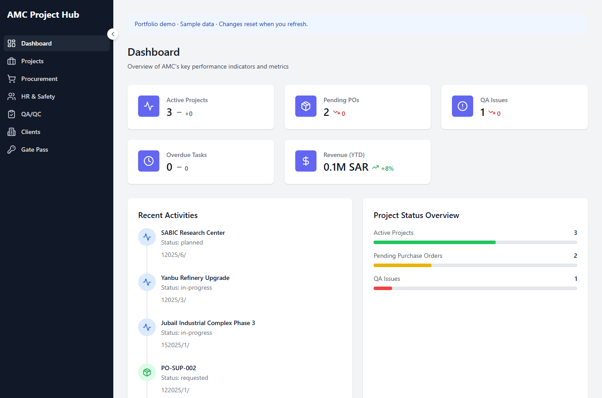

# AMC Project Hub

A React/TypeScript business-workflow application for managing contracting projects, procurement, employee records, quality checklists and site access. The portfolio demo runs on local sample data, so visitors can explore it without creating an account or configuring a database.

## Try it

- [Open the browser demo](https://hwq12331.github.io/AMC-Project-Hub-Portfolio/)
- [View the source](https://github.com/hwq12331/AMC-Project-Hub-Portfolio)



## Features

| Module | Implemented workflows |
| --- | --- |
| Dashboard | Active-project, procurement and QA summaries; recent activity |
| Projects | Create projects, track progress and update lifecycle status |
| Procurement | Create purchase orders and line items; calculate totals; update order status |
| HR & Safety | Add employees and record departments and certifications |
| QA/QC | Create checklists, edit inspection items, filter by category/risk/status and manage completion |
| Clients | Browse, add and filter client cards |
| Gate Pass | Register visitors/contractors, record check-in/check-out and cancel passes |

## Technology

React 18 · TypeScript · Vite · Tailwind CSS · React Router · Zustand · Supabase/PostgreSQL · Lucide icons

## Run locally

Requirements: Node.js 22 and npm.

```sh
git clone https://github.com/hwq12331/AMC-Project-Hub-Portfolio.git
cd AMC-Project-Hub-Portfolio
npm ci
npm run dev:demo
```

Open the local URL printed by Vite, normally **http://localhost:5173**. The commands work in Windows PowerShell, macOS and Linux.

The demo contains sample projects, employees, purchase orders, inspections and gate passes. Changes are stored in memory and reset when the page is refreshed. Client cards also use local component state. Some client-card action buttons are UI placeholders.

### Build and verify

```sh
npm run typecheck
npm run test:demo
npm run build:demo
npm run preview
```

The demo tests cover table loading, project updates, purchase-order totals, QA item updates, cascading deletion and gate-pass checkout. Hash-based routing supports direct navigation on static hosts such as GitHub Pages.

## Optional database-backed mode

1. Create your own Supabase project.
2. Apply the SQL files in `supabase/migrations/` in filename order to that project.
3. Copy `.env.example` to `.env` and set:

   ```dotenv
   VITE_APP_MODE=supabase
   VITE_SUPABASE_URL=https://YOUR_PROJECT.supabase.co
   VITE_SUPABASE_ANON_KEY=YOUR_PUBLIC_ANON_KEY
   ```

4. Run `npm run dev`.

The current database mode has no sign-in flow and includes anonymous CRUD policies for a demo database. The Clients screen remains local-state based. Local `.env` files are excluded from Git; `.env.example` contains placeholders only.

`npm run dev:demo` and `npm run build:demo` explicitly use sample data even when a local Supabase configuration exists.

## Project structure

```text
src/
  components/     Layout, sidebar and reusable dialogs
  pages/          Seven application modules
  lib/            Supabase client, demo adapter and sample records
  stores/         QA checklist state
  types/          Shared domain types
supabase/
  migrations/     Database schema and policy migrations
scripts/
  test-demo.mjs   Demo workflow regression checks
```

## Portfolio context

Created by **Hussain Alqassab**. This repository demonstrates workflow digitization, relational-data modeling, React/TypeScript interfaces and integration between business requirements and software implementation.

[GitHub profile](https://github.com/hwq12331) · [LinkedIn](https://www.linkedin.com/in/hussain-alqassab-0356b83b2/)
